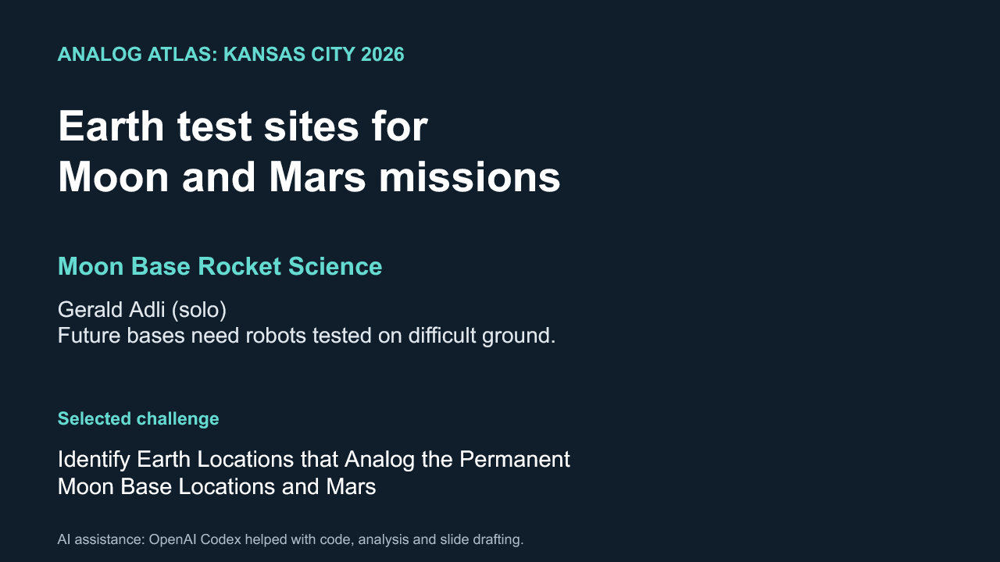
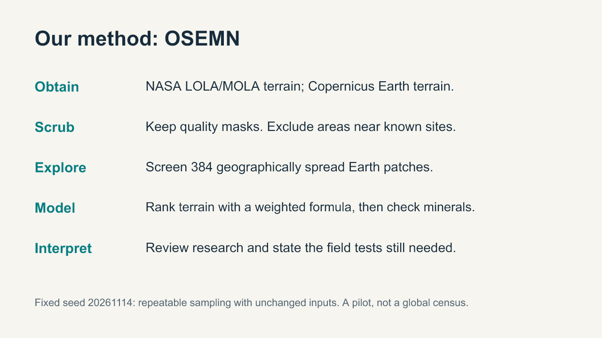
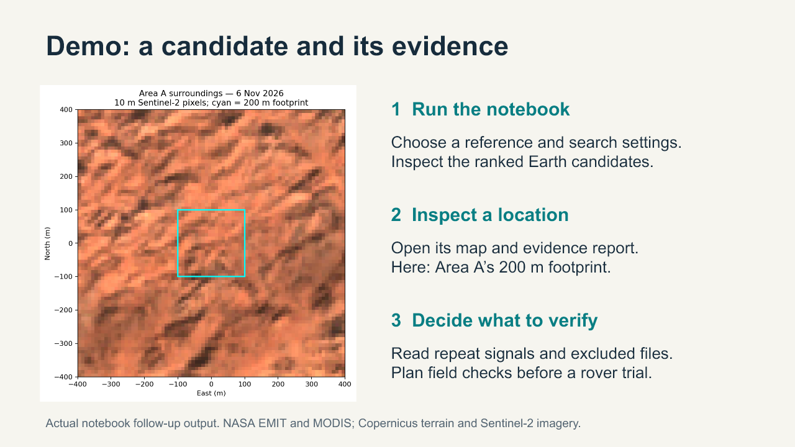
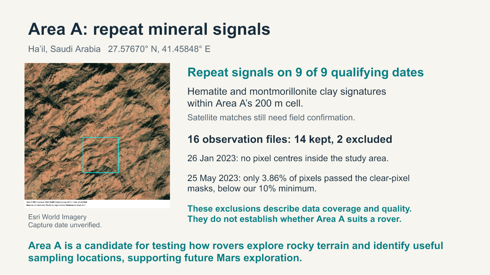
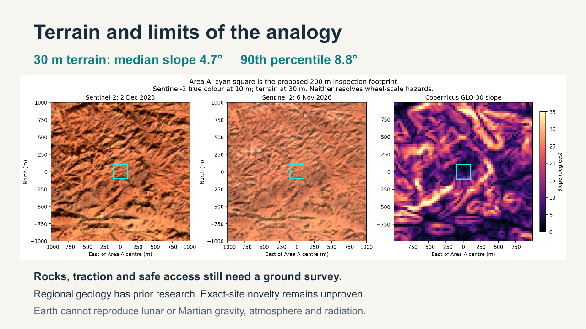
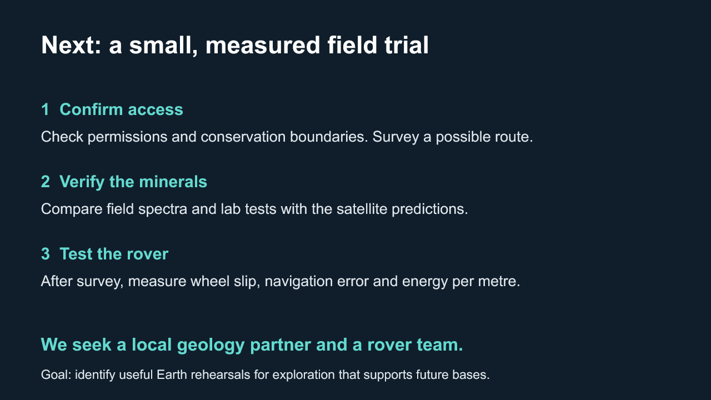

# Analog Atlas: Kansas City 2026

**Moon Base Rocket Science** — Gerald Adli (solo)

**Challenge:** Identify Earth Locations that Analog the Permanent Moon Base Locations and Mars

[Open the six-slide PDF demo](Analog_Atlas_Kansas_City_Demo.pdf)

NASA Space Apps Kansas City version. Six-slide project demo. Read the slides in order below, or open any slide at full size.

## Slide 1: Project and challenge

## Slide 2: Our method: OSEMN

## Slide 3: Demo: a candidate and its evidence

## Slide 4: Area A: repeat mineral signals

## Slide 5: Terrain and limits

## Slide 6: Next steps

[Speaking script](SPEAKING_SCRIPT.txt) · [Sources and limitations](SOURCES.md)
