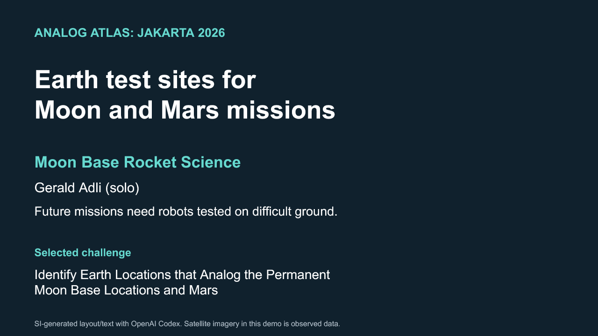
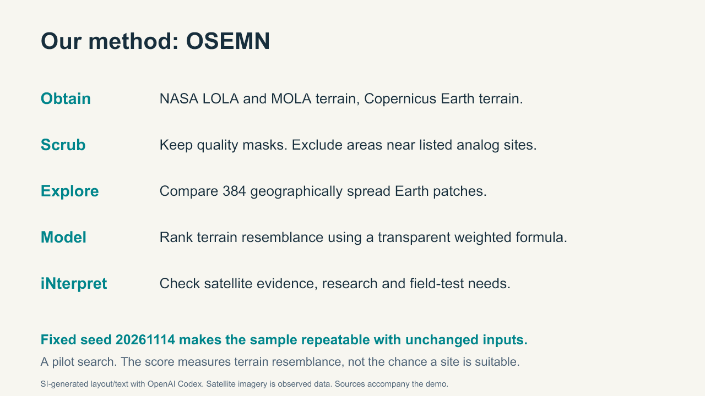
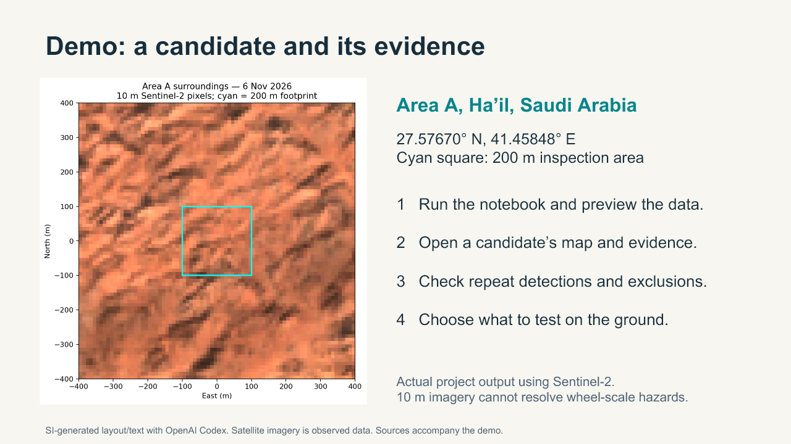
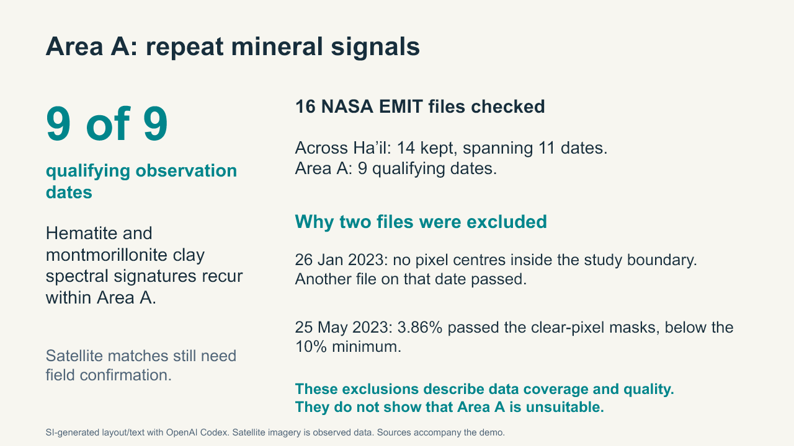
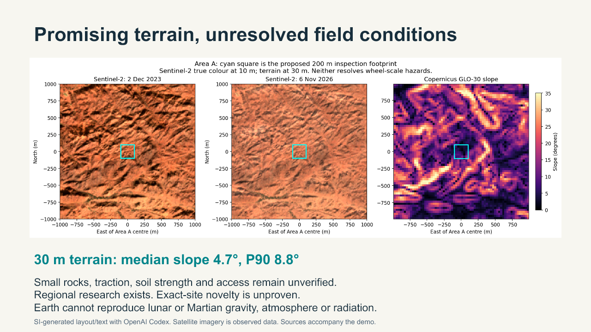
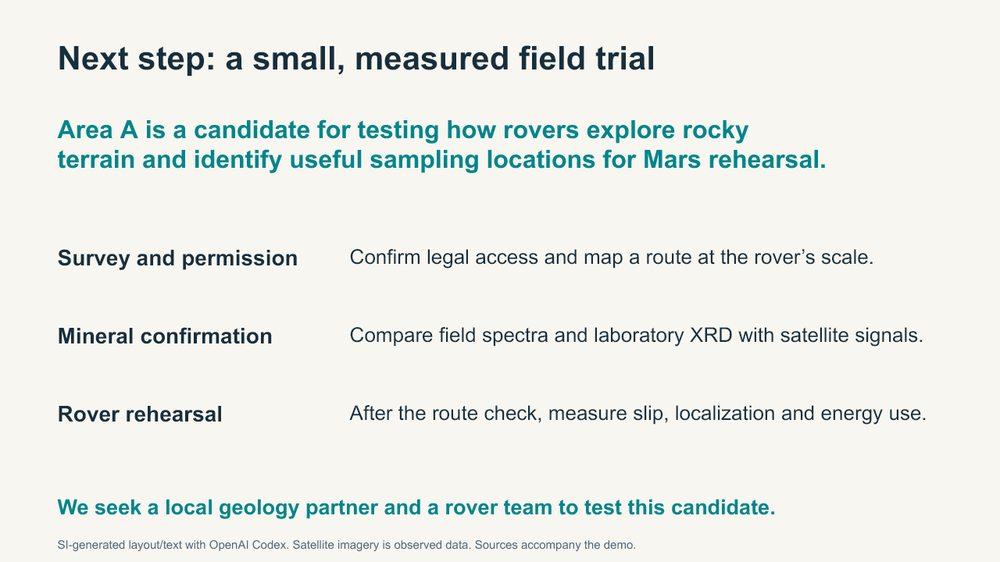

# Analog Atlas: Jakarta 2026

**Moon Base Rocket Science** — Gerald Adli (solo)

**Challenge:** Identify Earth Locations that Analog the Permanent Moon Base Locations and Mars

[Open the six-slide demo](Analog_Atlas_Jakarta_Demo.pdf)

Analog Atlas is a Python notebook and mapping workflow that identifies Earth locations worth investigating as rehearsal sites for Moon and Mars missions. Using the OSEMN framework, it compares Earth terrain with lunar south-pole and Martian Jezero reference patches, excludes listed analog sites, and checks shortlisted locations using satellite observations and published research. Our pilot sampled 384 Earth patches. Follow-up analysis identified Area A in Ha'il, Saudi Arabia, where hematite and montmorillonite clay spectral signatures recur on nine qualifying observation dates. The result is a candidate for investigating how rovers explore rocky terrain and select sampling locations. It is not yet a validated rover course or a confirmed new analog. By separating measured evidence from missing field tests, Analog Atlas helps teams decide where to investigate and what to measure before planning a mission rehearsal.

## Explore the project

- [Download the notebooks and evidence package](Analog_Atlas_Jakarta_Project.zip)
- [Sources, software and scientific limits](SOURCES_Jakarta.md)
- [Speaking script](SPEAKING_SCRIPT_Jakarta.txt)

The package contains the OSEMN discovery notebook, the 16-granule Ha’il follow-up notebook, source links, saved validation summaries and actual maps. The result can be inspected without registration. Re-running protected Earthdata downloads requires your own Earthdata account; credentials belong in Kaggle Secrets. This is a publication copy, not a new satellite run.

## Demo

### 1. Project and challenge

### 2. Method: OSEMN

### 3. Candidate and evidence

### 4. Repeat mineral signals

### 5. Terrain and limitations

### 6. Next steps

## SI disclosure

OpenAI Codex assisted with Python code, debugging, data-analysis workflows, literature-search support, interpretation drafts, documentation and presentation layout/text. Satellite images and source measurements come from the cited agencies and providers, not generative imagery. Derived maps and summaries were calculated by SI-assisted code. Presentation slides visibly disclose SI-generated layout/text. Shared notebooks and the project provenance metadata acknowledge SI assistance. Independent checks reconstructed the uploaded derived repeat-detection results; raw EMIT NetCDF quality masks were not reprocessed during that validation. Field confirmation remains outstanding.

The earlier [Kansas City deck](Analog_Atlas_Kansas_City_Demo.pdf) is retained as an archive. The current submission materials focus on Jakarta. Public hosting does not establish event registration or submission eligibility.
